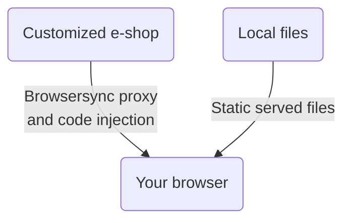

# Shoptet Bender 🤖
## Introduction
Shoptet Bender proxies remote e-shop to localhost while injecting and serving your local JavaScripts and CSS styles. This tool enables the development of visual changes without breaking the production e-shop. It is also suitable for Premium e-shop development, while emulation of the Blank mode is possible.

## How it works



## Install
Node >= 18 prerequisited\
Install global using yarn:\
`yarn global add git+https://github.com/shoptet/shoptet-bender.git`

ℹ️ On Windows platform, you may need to add Yarn binary to your path:
- copy the output of the `yarn global bin` command, e.g. *C:\Users\YOUR_PROFILE\AppData\Local\Yarn\bin*
- open "**System properties**" and click on the "**Environment Variables**" button
- select "**Path**", click on "**Edit**" -> "**New**", paste the copied output and save
- you need to open a new instance of the CLI interface to take an effect

## Usage
### Step-by-step guide to start

1. 📁 If you want to use the prepared build step, create a following folder structure:

```
src/
├── footer/
│   ├── script1.js
│   └── script2.js
├── header/
│   ├── markup.html
│   └── style.css
└── orderFinale/
    └── remarketing.js
```

2. 📝 Create or move your script and styles to the corresponding folders
3. 🖥️ Choose e-shop url, let's say Classic `shp-bender --remote https://classic.shoptet.cz/`

And you're ready to go -> enjoy coding and development 🎉

**OR**

Try `shp-bender -h` for CLI help

**OR**

🚀 Use our [Boilerplate wizard](https://github.com/shoptet/create-visual-addon-boilerplate) for even faster start. 🚀

### Removing existing scripts and styles

If you want to remove existing scripts and styles, you can use the `--removeHeaderIncludes` or `--removeFooterIncludes` flag followed by the string you want to remove. You can target for example number of the addon, or specific URL, project includes or comment in the script.

Those two flags drop the **whole include block**, which usually contains third party addons as well. To remove only selected files, use `--removeAssets` (or the `removeAssets` key in the project's `config.json`) with a list of substrings — every `<script src>` / `<link href>` whose URL contains one of them is stripped, and the rest of the block stays untouched.

The typical use case is the project's own production bundle: without it, the deployed build runs alongside the local one and every DOM change is applied twice.

```json
{
  "defaultUrl": "https://www.example.com/",
  "sourceFolder": "./src",
  "outputFolder": "./dist-bender",
  "removeAssets": ["myproject.js", "myproject.css"]
}
```

> Note: `config.json` is read from the directory you run Bender in — the client project, not this repository.

### Public preview for the client (fork tomasganoci)

Cloudflare tunnel `project.tomasganoci.cz` points to `localhost:3010`. Port 3010 belongs to a small router (`router.js`), Benders themselves start at port 3020 (BrowserSync takes the next free one). Every Bender registers its port in `~/.shoptet-bender/nahledy.json` under the project slug (folder name without `.cz`, `.sk`, ...) and starts the router in the background if it is not running yet. After start it prints the link for the client:

```
Náhled pro klienta: https://project.tomasganoci.cz/?nahled=proterasy
```

- `?nahled=<slug>` sets the `bender_nahled` cookie and redirects to the same URL without the parameter, so the client can click through the whole shop.
- Without the cookie the router uses the only running Bender, if exactly one runs.
- Unknown or stopped project shows "Náhled teď neběží"; the list of projects is never exposed.
- One browser shows one project at a time; another `?nahled=` link switches it.
- No new hostname in Cloudflare is needed for a new project.
- The router listens on loopback only and accepts both http and https on the same port. `BENDER_ROUTER_PORT` overrides the port for testing.

### Before/after comparison (fork tomasganoci)

`/__porovnani` on any running Bender (locally `https://localhost:3020/__porovnani`, on a preview e.g. `https://nahled-svetpeceni.tomasganoci.cz/__porovnani`) shows the live shop without our changes ("Před") next to the shop with the changes from Bender ("Po"). Code: `porovnani.js`.

- `?url=/kategorie/` opens a given page; the address field also accepts a full shop URL.
- Both sides follow the same page: a click in either side navigates the other one too. Scrolling is shared by page-height ratio ("Posouvat spolu").
- "Přepínat" shows one side at full width, the button or key P switches Před/Po.
- "Šířka stránky" renders the page at 390 / 820 / 1180 / 1440 / 1920 px and scales it down to fit.
- The "Před" side is served by Bender under the `/__puvodni/` prefix: the request goes to the shop as usual, but none of the rewrite rules for our includes run, so the HTML codes (header/footer, including the production bundle) stay as in production. Both frames are same-origin with the comparison page, which is why the live shop's `X-Frame-Options: SAMEORIGIN` does not block them.
- BrowserSync ghost mode (mirroring clicks and scroll between clients) is turned off, otherwise preview visitors would mirror each other and the two sides would fight over scrolling.

## Possible tool improvements
Shoptet Bender is an open-source project, and we’d love your help! Shoptet doesn’t have the resources to work on this tool continuously, so it’s a great chance for you to jump in and make it better. We’ve listed some feature ideas to get you started, but feel free to create your own. Even small updates can make a big difference, and your contributions are really valued!
